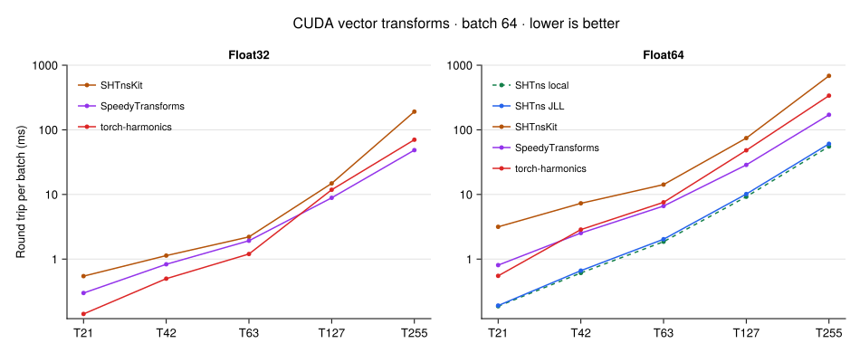

# Spherical harmonic transforms

CUDA vector transforms using SHTns.jl, SHTnsKit.jl, SpeedyTransforms.jl and
torch-harmonics. Requirements: Linux x86_64, Julia 1.11.9, Python ≥3.11, Bash,
tar, sha256sum, uv for PyTorch, a compatible NVIDIA driver and network access.

## Run

From this directory:

```sh
export JULIA=/path/to/julia-1.11.9/bin/julia
export JULIA_DEPOT_PATH="$PWD/.depot"
bash scripts/setup.sh
bash scripts/run.sh all --out=results/run
python3 scripts/report.py results/run
```

`all` selects `shtns-jll`, `shtnskit` and `speedy`. SHTns_jll uses CUDA 12.9
and supports Float64 through the pinned wrapper. Sources and licenses are
archived under `sources/`; manifests and runtime preferences are under
`environments/`.

For the PyTorch backend:

```sh
JULIA=/path/to/julia-1.11.9/bin/julia bash scripts/run_torch.sh \
  --out=results/torch-minute --seconds-total=60
python3 scripts/report.py results/torch-minute
```

The PyTorch environment is pinned by `environments/torch/uv.lock` and uses
PyTorch 2.9.1 with NVIDIA's `torch-harmonics-cu130` 0.9.3 wheel. Fixture
coefficients are exported from Julia to keep the analytic fields identical.

## Protocol

- Batch: 64 tangential vector fields, with two real components each.
- Precisions: Float32 and Float64; unsupported combinations are recorded.
- Operations: velocity → divergence/vorticity, inverse reconstruction, round trip.
- Julia backends use preallocated inputs, outputs, scratch buffers and plans.
- torch-harmonics returns tensors through its public API; CUDA Graph capture
  retains internal buffers in a fixed pool. Inputs are uploaded before capture
  and timing. Each measured graph is rejected if it contains host↔device memcpy
  or uninspected child-graph nodes; device-to-device copies are reported.
- Julia timed calls allocate zero CPU/GPU bytes. PyTorch replay adds no CUDA
  allocations per call; eager-call peak memory and graph-pool size are recorded.
- CUDA events measure device time; all context streams are synchronized after
  each sample. Preparation, validation, compilation and warmup are excluded.
- Budget: approximately 60 GPU seconds across the default comparison, with
  at least 10 samples per operation. `--seconds-total=N` overrides the budget
  **per backend**. Small transforms repeat within each sample to target 2 ms.
- Independent analytic fields validate velocity, divergence and vorticity.
  Relative L2 tolerances: 5e-4 for Float32, 5e-10 for Float64. Graph outputs
  and post-measurement reconstruction are checked. The fixture samples a
  sparse set of low, intermediate and near-cutoff modes, not every coefficient.

SHTns uses its public in-place API. SHTnsKit and SpeedyTransforms adapters
compose pinned internal kernels and reuse FFT plans and buffers. PyTorch uses
the public vector SHT modules and cuFFT; a prebuilt Hermitian mask makes inverse
FFT graph capture safe.

| Truncation | Maximum degree | Latitude × longitude | Longitude spacing |
|---|---:|---:|---:|
| T21 | 21 | 32 × 64 | 5.625° |
| T42 | 42 | 64 × 128 | 2.8125° |
| T63 | 63 | 96 × 192 | 1.875° |
| T127 | 127 | 192 × 384 | 0.9375° |
| T255 | 255 | 384 × 768 | 0.46875° |

Gaussian latitudes are not evenly spaced. Grid spacing differs from the
smallest represented equatorial wavelength, approximately 360°/lmax.

## Options and results

```sh
bash scripts/run.sh all --lmax=21 --validate-only --out=results/check
bash scripts/run.sh speedy --precision=Float32 --lmax=63,127 --seconds-total=10
```

Reports validate recorded metadata, numerical errors, timings and allocations.
Raw TOML results include samples, wall times, versions, source revisions and
library hashes. Recorded paths are provenance, not reproduction inputs.

- [Three-library results](results/inplace-minute/summary.md)
- [SHTns_jll results](results/jll-cuda12.9/summary.md)
- [PyTorch results](results/torch-minute/summary.md)

Reference GPU: RTX PRO 1000 Blackwell Laptop, 8151 MiB, compute capability 12.0.
Use AC power and an otherwise idle GPU. Compare timings at the same precision;
local SHTns 3.7.5/CUDA 13.1 and JLL SHTns 3.7.0/CUDA 12.9 differ in both versions.

For the optional local build, set `CUDA_PATH` (CUDA 13.1) and `CUDA_ARCH`, run
`setup.sh shtns` then `build_shtns.sh`, and select `run.sh shtns`. Set
`CUDA_MATH_LIBS` if math libraries are outside the toolkit's `lib64` directory.

## Results



torch-harmonics is fastest in Float32 through T63; SpeedyTransforms is faster
at T127 and T255. SHTns is fastest in Float64. At T255, round trips take
**48.48 ms** (SpeedyTransforms Float32), **60.70 ms** (SHTns JLL Float64), and
**337.75 ms** (torch-harmonics Float64). All measured cases pass validation;
captured PyTorch graphs contain no host↔device memcpy nodes. Synthesis and
round-trip graphs include a device-to-device copy, which is included in their
reported device time.

Regenerate the figure with Julia:

```sh
"$JULIA" --project=plotting -e 'using Pkg; Pkg.instantiate()'
"$JULIA" --project=plotting scripts/plot_results.jl
```
