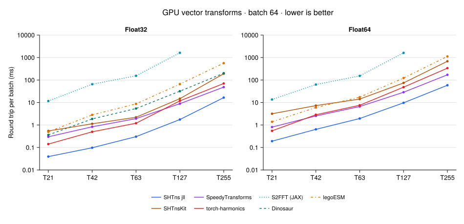

# Spherical harmonic transforms

CUDA vector transforms using SHTns.jl, SHTnsKit.jl, SpeedyTransforms.jl and
torch-harmonics. Requirements: Linux x86_64, Julia 1.11.9, Python ≥3.11, Bash,
tar, sha256sum, uv for PyTorch, a compatible NVIDIA driver and network access.

## Run

From this directory:

```sh
export JULIA=/path/to/julia-1.11.9/bin/julia
export JULIA_DEPOT_PATH="$PWD/.depot"
bash scripts/setup.sh
bash scripts/run.sh all --out=results/run
python3 scripts/report.py results/run
```

`all` selects `shtns-jll`, `shtnskit` and `speedy`. SHTns_jll uses CUDA 12.9
and supports Float64 through the pinned wrapper. Sources and licenses are
archived under `sources/`; manifests and runtime preferences are under
`environments/`.

For the PyTorch backend:

```sh
JULIA=/path/to/julia-1.11.9/bin/julia bash scripts/run_torch.sh \
  --out=results/torch-minute --seconds-total=60
python3 scripts/report.py results/torch-minute
```

For S2FFT with JAX/CUDA:

```sh
JULIA=/path/to/julia-1.11.9/bin/julia bash scripts/run_jax.sh \
  --out=results/jax-minute --lmax=21,42,63,127 --seconds-total=10
python3 scripts/report.py results/jax-minute
```

The JAX environment is pinned by `environments/jax/uv.lock`. It uses S2FFT's
spin spherical transforms on its native Gauss-Legendre grid. JAX calls are
compiled and use GPU-resident arrays; synchronized wall timings include host
dispatch but exclude transfers. Its bandlimit is `lmax+1`, matching the
inclusive triangular truncation. S2FFT uses its native GL grid of `lmax+1`
latitudes and `2*(lmax+1)-1` longitudes; grid sizes therefore differ from the
other backends even though the spectral cutoff matches.
The current S2FFT recursion path is measured through T127; T255 exceeds GPU
memory during compilation on the reference GPU. Timings use a 10-second budget
per invocation; the minimum-sample requirement can extend this for slow cases.

For Dinosaur's GCM vector conversions:

```sh
JULIA=/path/to/julia-1.11.9/bin/julia bash scripts/run_dinosaur.sh \
  --out=results/dinosaur-minute --seconds-total=60
python3 scripts/report.py results/dinosaur-minute
```

For legoESM's Gaussian-grid vector conversions (Float32 and Float64):

```sh
bash scripts/run_legoesm.sh --out=results/legoesm-minute --seconds-total=60
python3 scripts/report.py results/legoesm-minute
```

The runner unpacks the pinned `legoesm-core` source snapshot in `sources/` and
uses the locked JAX/CUDA environment. It chooses a memory-safe chunk size by
truncation and uses quadratic dealiasing. Float32 vector analysis
promotes coefficients to Complex128; the benchmark casts them back to
Complex64 and includes that cast in timing. On CPU-only systems, numerical
validation works with `--validate-only --allow-cpu-validation` and records no
timings.

The pinned `environments/dinosaur/uv.lock` environment uses Dinosaur's fast
real spherical harmonics with FFT longitude transforms and its native
wind↔vorticity/divergence operators. The benchmark grid is `(longitude,
latitude)`. Its analytic fixture omits the top total wavenumber, which the GCM
clips during vector tendency calculations. Float64 is recorded unsupported:
the Float32 modal path does not meet the Float64 accuracy threshold.

The PyTorch environment is pinned by `environments/torch/uv.lock` and uses
PyTorch 2.9.1 with NVIDIA's `torch-harmonics-cu130` 0.9.3 wheel. Fixture
coefficients are exported from Julia to keep the analytic fields identical.

## Protocol

- Batch: 64 tangential vector fields, with two real components each.
- Precisions: Float32 and Float64; unsupported combinations are recorded.
- Operations: velocity → divergence/vorticity, inverse reconstruction, round trip.
- Julia backends use preallocated inputs, outputs, scratch buffers and plans.
- torch-harmonics returns tensors through its public API; CUDA Graph capture
  retains internal buffers in a fixed pool. Inputs are uploaded before capture
  and timing. Each measured graph is rejected if it contains host↔device memcpy
  or uninspected child-graph nodes; device-to-device copies are reported.
- Julia timed calls allocate zero CPU/GPU bytes. PyTorch replay adds no CUDA
  allocations per call; eager-call peak memory and graph-pool size are recorded.
- CUDA events measure device time; all context streams are synchronized after
  each sample. Preparation, validation, compilation and warmup are excluded.
- Budget: approximately 60 GPU seconds across the default comparison, with
  at least 10 samples per operation. `--seconds-total=N` overrides the budget
  **per backend**. Small transforms repeat within each sample to target 2 ms.
- Independent analytic fields validate velocity, divergence and vorticity.
  Relative L2 tolerances: 5e-4 for Float32, 5e-10 for Float64. Graph outputs
  and post-measurement reconstruction are checked. The fixture samples a
  sparse set of low, intermediate and near-cutoff modes, not every coefficient.

SHTns uses its public in-place API. SHTnsKit and SpeedyTransforms adapters
compose pinned internal kernels and reuse FFT plans and buffers. PyTorch uses
the public vector SHT modules and cuFFT; a prebuilt Hermitian mask makes inverse
FFT graph capture safe.

| Truncation | Maximum degree | Latitude × longitude | Longitude spacing |
|---|---:|---:|---:|
| T21 | 21 | 32 × 64 | 5.625° |
| T42 | 42 | 64 × 128 | 2.8125° |
| T63 | 63 | 96 × 192 | 1.875° |
| T127 | 127 | 192 × 384 | 0.9375° |
| T255 | 255 | 384 × 768 | 0.46875° |

Gaussian latitudes are not evenly spaced. Grid spacing differs from the
smallest represented equatorial wavelength, approximately 360°/lmax.

## Options and results

```sh
bash scripts/run.sh all --lmax=21 --validate-only --out=results/check
bash scripts/run.sh speedy --precision=Float32 --lmax=63,127 --seconds-total=10
```

Reports validate recorded metadata, numerical errors, timings and allocations.
Raw TOML results include samples, wall times, versions, source revisions and
library hashes. Recorded paths are provenance, not reproduction inputs.

- [Three-library results](results/inplace-minute/summary.md)
- [SHTns_jll results](results/jll-cuda12.9/summary.md)
- [PyTorch results](results/torch-minute/summary.md)
- [S2FFT/JAX results](results/jax-minute/summary.md)
- [Dinosaur results](results/dinosaur-minute/summary.md)
- [legoESM results](results/legoesm-minute/summary.md)

Reference GPU: RTX PRO 1000 Blackwell Laptop, 8151 MiB, compute capability 12.0.
Use AC power and an otherwise idle GPU. Compare timings at the same precision;
local SHTns 3.7.5/CUDA 13.1 and JLL SHTns 3.7.0/CUDA 12.9 differ in both versions.

For the optional local build, set `CUDA_PATH` (CUDA 13.1) and `CUDA_ARCH`, run
`setup.sh shtns` then `build_shtns.sh`, and select `run.sh shtns`. Set
`CUDA_MATH_LIBS` if math libraries are outside the toolkit's `lib64` directory.

## Results



SHTns JLL with the Float32 wrapper is fastest in Float32 among the recorded
runs; the local SHTns build remains fastest in Float64. At T255, round trips take **16.53 ms** (SHTns JLL Float32),
**48.48 ms** (SpeedyTransforms Float32), **58.69 ms** (SHTns JLL Float64), and
**337.75 ms** (torch-harmonics Float64). All supported measured cases pass validation;
captured PyTorch graphs contain no host↔device memcpy nodes. Synthesis and
round-trip graphs include a device-to-device copy, which is included in their
reported device time. The SHTns JLL curves use the public API run in
[CUDA Float32 results](results/cuda-float32/summary.md); T255 Float32 uses the
explicit single-block reduction profile described in
[validation notes](results/cuda-float32/VALIDATION.md).
S2FFT/JAX is slower on the shared Float32 range: round trips take **11.64 ms**
at T21 and **1.62 s** at T127. With synchronized wall timing, Dinosaur is
about 32× and 8× faster at those truncations. S2FFT has no T255 result.
Dinosaur is far faster than S2FFT on the shared range, but its vector round
trips are slower than torch-harmonics and SpeedyTransforms: **0.36 ms** at T21
and **201.11 ms** at T255, Float32. JAX timings are synchronized wall times
including dispatch; other backends use CUDA-event device times, so the combined
plot is indicative rather than a strict timing-method comparison. Dinosaur has
no validated Float64 result.
legoESM passes all measured truncations in both precisions. Its round trips take
**0.50 ms** (Float32) and **1.39 ms** (Float64) at T21, rising to **562 ms** and
**1.12 s** at T255. With the same JAX wall-time method, Dinosaur is faster in
Float32 by about 1.4× at T21 and 2.8× at T255. SpeedyTransforms remains faster
in the recorded results, though those Julia timings measure CUDA device time.

Regenerate the figure with Julia:

```sh
"$JULIA" --project=plotting -e 'using Pkg; Pkg.instantiate()'
"$JULIA" --project=plotting scripts/plot_results.jl
```


## SHTns.jl CUDA Float32 development run

The `shtns-float32` environment uses a source snapshot of the local SHTns.jl
branch `codex/cuda-float32` (`d9981b8`), based on upstream `db5168a`.
It uses the same SHTns_jll 3.7.0+0 binary and CUDA 12.9 preferences as
`shtns-jll`. The snapshot, commit and checksum are recorded in `sources/`;
no GitHub fork or external unpublished branch is needed to reproduce it.

```sh
bash scripts/setup.sh shtns-float32
bash scripts/run.sh shtns-float32 --seconds-total=60 --out=results/cuda-float32
python3 scripts/report.py results/cuda-float32
```

The companion `scripts/verify_shtns_float32.sh` has four stages: `prototype`,
`package`, `tests`, and `diagnostic`. Set `JULIA` and `JULIA_DEPOT_PATH` as
needed; its defaults use the Julia 1.11.9 juliaup installation and the cached
benchmark depot on the development machine. The prototype directly calls the
Float32 C entry points and works with the original pinned SHTns.jl package.
The package stage uses only public SHTns.jl transforms from the patched source.
The test stage runs the original CUDA tests plus Float32/Float64 coverage.

At T255, batch 64, Float32 uses an explicit SHTns GPU tuning profile
`[nwarp_s,nf_s,nw_s,nwarp_a,nf_a,lspan_a]=[4,4,2,6,4,12]`. Its single
192-thread latitude block removes inter-block atomic accumulation, whose
run-to-run roundoff otherwise exceeds the strict graph/direct check of 1e-5.
Other cases retain SHTns' default GPU configuration. The profile is recorded in
the result notes; all numerical and allocation checks retain their thresholds.
This is a benchmark configuration, not a wrapper API change or an automatic
tuning recommendation for other devices or workloads.

To reproduce the variability diagnostic using the original C defaults:

```sh
bash scripts/verify_shtns_float32.sh diagnostic --default
bash scripts/verify_shtns_float32.sh diagnostic --full-spectrum
```

The second command checks deterministic repetition and compares T255 synthesis
against a CPU Float64 reference with random coefficients spanning the complete
spectrum, followed by a spectral round trip. The original pinned environments
and historical results are preserved; the reporter detects recorded precision
capabilities rather than assuming SHTns always lacks Float32.
